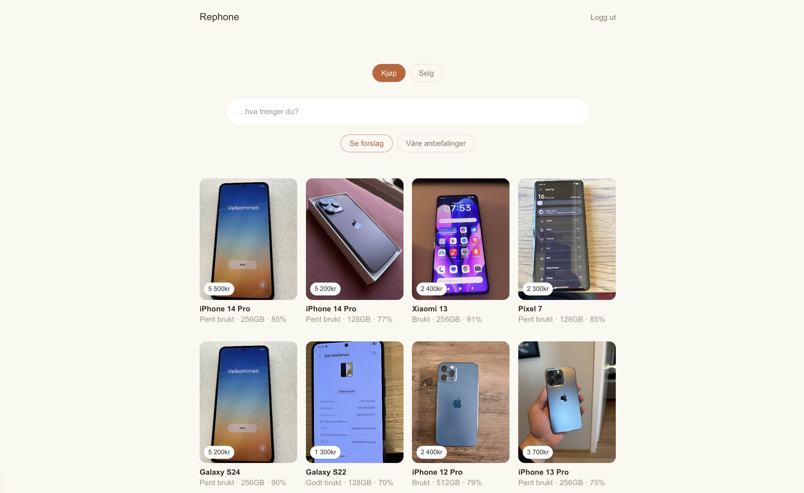
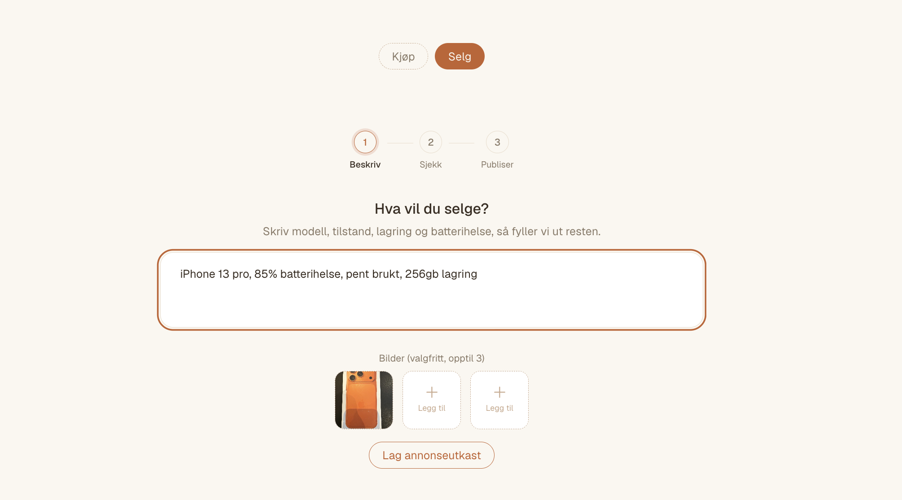
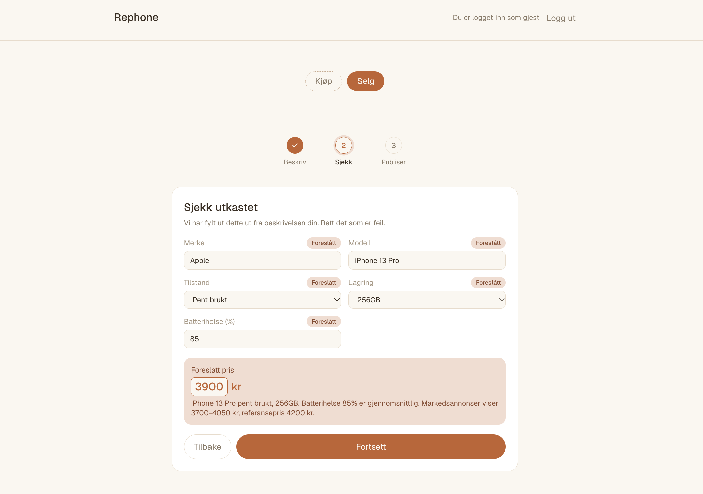

# Rephone 📱

A marketplace for used phones where the AI never guesses without data. Search in plain language, get price suggestions grounded in real listings and reference prices, and publish a listing in three steps.


**[Live Demo](https://rephone-rho.vercel.app)**

<table>
  <tr>
    <td width="33%" align="center">
      <br>
      <sub><b>1. Search</b><br>Write naturally, see what the AI understood</sub>
    </td>
    <td width="33%" align="center">
      <br>
      <sub><b>2. Describe</b><br>One sentence is enough to start a listing</sub>
    </td>
    <td width="33%" align="center">
      <br>
      <sub><b>3. Check</b><br>Review the AI draft and the suggested price</sub>
    </td>
  </tr>
</table>

---

## Features

- **Natural language search**: Write "an iPhone under 4000 kr, over 80% battery health and at least 256 GB" and get matching listings, with the interpreted filters shown as chips
- **Rich filters**: Budget, minimum price, brand, model, battery health, storage, condition (several at once) and sorting
- **Honest about limits**: Requirements the app can't filter on yet show up as dimmed "ikke støttet enda" chips instead of being silently ignored
- **Pagination**: "Viser 10 av 14" with a "Vis flere" button. Extra pages reuse the saved filters, so no extra AI call
- **AI price suggestion**: Describe your phone in free text and get brand, model, condition, battery health, storage and a suggested price
- **Guided 3-step sell flow**: Describe, check the draft, publish. Suggested fields are marked, and the back button never loses your input
- **Live price updates**: Change storage, battery health or condition and the price follows
- **AI-written ad text**: Generate a short, honest description from the draft, and regenerate if you don't like it
- **Image upload**: Photos go to Vercel Blob and show on cards and the detail page
- **Auth and guest mode**: Register with email and password, or continue as a guest to try the app. Only the owner can edit or delete a listing

---

## How the AI works

The AI is built around one rule: **retrieve real data first, then let the model reason over it.**

**Search (buy)**

1. Claude interprets the free text into structured filters (budget, brand, model, battery health, storage, conditions, sorting, priorities, and anything unsupported)
2. A normal Prisma query fetches real listings that match the filters
3. Claude writes a short reason for each real match
4. "Show more" reuses the saved filters and only fetches the next page, so the interpretation step is skipped

**Price suggestion (sell)**

1. Claude interprets the description into brand, model, condition, battery health and storage
2. The database is queried for similar active listings **and** a seeded reference price table
3. Claude suggests a price, with real listings prioritised over reference prices
4. If neither source has data, the app refuses to guess and says so

**Price adjustment**
Only the first suggestion comes from the model. When storage or battery health changes, the new price is calculated in plain code (storage steps and a battery health penalty). Changing condition, brand or model asks for a fresh suggestion. This came out of testing: the model was not consistent enough for purely numeric adjustments.

---

## Evals

The search route has its own test set, because "it looked right when I tried it" doesn't hold up for LLM output.

- **Precision**: every returned listing must satisfy the filters
- **Recall**: the expected listings are counted straight from the database, not hard-coded
- **Totals and sorting**: `total` must match the database count, and sorted results must actually be in order
- **Hold-out set**: cases the prompt was never tuned on, to catch overfitting

**Current status (2026-10-15): all eval cases pass, including the hold-out set.**

```bash
npx tsx eval/run.ts            # run all cases
npx tsx eval/run.ts --runs 5   # repeat to check stability
```

---

## Tech Stack

- **Next.js** (App Router): Framework
- **React** and **TypeScript**: UI
- **Tailwind CSS**: Styling
- **PostgreSQL on Neon**: Database
- **Prisma**: ORM, with the `PrismaPg` driver adapter
- **Auth.js (NextAuth)**: Credentials login with JWT sessions, passwords hashed with bcrypt
- **Anthropic Claude API**: Search interpretation, price suggestions and ad text
- **Vercel Blob**: Image storage
- **Vercel**: Deployment

---

## Getting Started

### Prerequisites

- Node.js
- A PostgreSQL database (for example on [Neon](https://neon.tech))
- An [Anthropic API key](https://console.anthropic.com)
- A [Vercel Blob](https://vercel.com/docs/vercel-blob) store with public access

### Installation

```bash
git clone https://github.com/NikolaiVFredriksen/Rephone
cd Rephone
npm install
```

### Environment Variables

Create a `.env` file in the root:

```
DATABASE_URL=your_postgres_connection_string
ANTHROPIC_API_KEY=your_anthropic_api_key
AUTH_SECRET=a_long_random_string
BLOB_READ_WRITE_TOKEN=your_vercel_blob_token
DEMO_USER_EMAIL=demo_account_email
DEMO_USER_PASSWORD=demo_account_password
```

`DEMO_USER_EMAIL` and `DEMO_USER_PASSWORD` power the guest button. Any values work, the seed script below creates the account.

### Database Setup

```bash
npx prisma migrate dev
npx prisma generate
npx tsx prisma/seed-reference-prices.ts
npx tsx prisma/seed-demo-user.ts
```

The reference price script fills the price table with approximate used prices for iPhone, Samsung, Pixel and Xiaomi models in four conditions. Most are estimates, not market data.

Optional: put photos in an `annonser/` folder (gitignored) and run the listing seed to get example listings:

```bash
npx tsx --env-file=.env.local prisma/seed-listings.ts
```

### Run Locally

```bash
npm run dev
```

---

## Project Structure

```
eval/                      Search eval runner, cases and hold-out set
docs/                      Work logs per feature
prisma/
├── schema.prisma
├── seed-reference-prices.ts
├── seed-demo-user.ts
└── seed-listings.ts
src/
├── app/
│   ├── actions/           (guest-login)
│   ├── api/
│   │   ├── search/
│   │   ├── price-suggestion/
│   │   ├── adjust-price/
│   │   ├── generate-description/
│   │   ├── listings/
│   │   ├── upload/
│   │   ├── register/
│   │   └── auth/
│   ├── annonse/[id]/
│   ├── logg-inn/
│   ├── registrer/
│   └── page.tsx
├── components/
│   ├── shared/   (Header, Hero, Footer, BuySellToggle, ListingCard, ResultsGrid, skeletons, GuestButton)
│   ├── buy/      (BuyFlow, FilterChips)
│   ├── sell/     (SellFlow, SellGate, StepIndicator, ImageUploader, EditDraftStep, GenerateDescription)
│   └── HomeContent.tsx
├── lib/
│   └── prisma.ts
└── auth.ts
```

---

## Known Limitations

- Only the first uploaded image is stored on a listing
- Images are not analysed by the AI yet. Condition, storage and battery health come from the seller's text, so the draft is only as accurate as the description
- Reference prices are estimates, and the newest models have no real used market yet
- Search handles one brand at a time

## Roadmap

**Vision, next up.** Images are already uploaded and stored, so the next step is to send them to a vision-capable model and use what it sees to ground the draft:

- Read the settings screenshot (battery health, storage, model name) and fill those fields from the image instead of relying on typed text
- Assess visible condition (cracks, scratches, wear) and suggest `Pent brukt`, `Brukt` or `Godt brukt`
- Flag mismatches, for example a description saying "like new" next to a photo of a cracked screen
- Let the price suggestion use the vision result as another grounded input, next to real listings and reference prices
- Keep the seller in control: vision only pre-fills the editable draft, and every field can still be changed

**After that**

- Evals for the sell flow, the same way search is tested today
- Real-time market prices through a pricing API or a web search tool for the model
- Profile page with "my listings"
- Multiple images per listing

---

## Author

Nikolai Villanueva Fredriksen
[GitHub](https://github.com/NikolaiVFredriksen)
